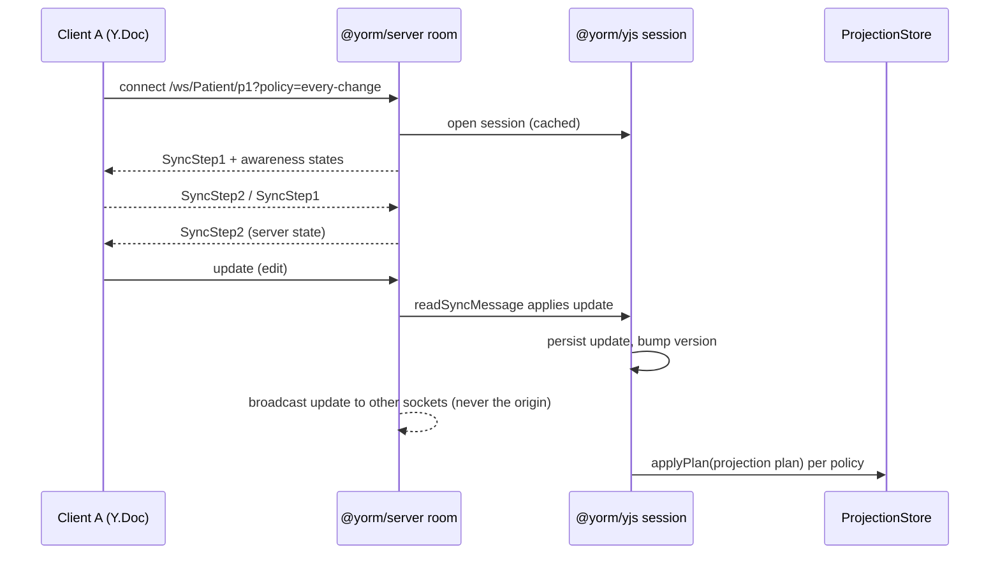

# @yorm/server

The framework-neutral YORM server: **one implementation of the wire protocol**
(HTTP routes + the Yjs WebSocket endpoint) that the transport adapters —
[@yorm/hono](../hono/README.md), [@yorm/fastify](../fastify/README.md),
[@yorm/express](../express/README.md) — mount into their host framework.

This package is the authoritative description of that protocol. The adapter
READMEs cover only how to mount it; everything about routes, query params,
options, and behavior lives here.

```ts
import { createYormServer } from "@yorm/server";

const server = createYormServer(yorm, options);
server.routes; // YormRoute[] — method + colon-style path + handle(request)
server.websocket; // YormWebSocketEndpoint — path + connect(request)
```

Both share **one session cache**, which is why HTTP writes reach connected
WebSocket clients. The package only sees `Yorm` interfaces from
[@yorm/yjs](../yjs/README.md) — it has **no dependency on any DB package** and
no dependency on any HTTP framework.

## Neutral contracts

An adapter's whole job is to map its framework's request/socket onto these:

```ts
interface YormRequest {
  readonly method: string;
  readonly path: string;
  param(name: string): string | undefined; // :type / :id / :pid
  query(name: string): string | undefined;
  header(name: string): string | undefined;
  json(): Promise<unknown>;
  rawBody(): Promise<Uint8Array>; // for signature verification
}

interface YormResponse {
  status: number;
  body?: unknown; // undefined ⇒ empty body (204)
}

interface YormSocket {
  send(data: Uint8Array): void;
  close(code: number, reason?: string): void;
}
```

Two rules an adapter must honor:

- **Body**: read it once, as bytes. `json()` and `rawBody()` must both work
  (webhook signatures need the exact bytes); a malformed body must surface as
  YORM's `400 { error }`, not the framework's own error page.
- **Socket identity**: pass the **same `YormSocket` object** for every event of
  a connection. Room fan-out skips the origin socket by reference, so a fresh
  wrapper per event would echo a client's own updates back to it.

## HTTP routes

All routes are JSON and run `onAuthorize` first (`403` on refusal).
Malformed bodies yield `400`; unexpected errors yield `500 { error }`.

| Method | Path                               | Body                                    | Response                                                |
| ------ | ---------------------------------- | --------------------------------------- | ------------------------------------------------------- |
| GET    | `/docs/:type/:id`                  | —                                       | `{ object, version }`, `404` if never persisted         |
| PUT    | `/docs/:type/:id`                  | the document object                     | `{ version }` (semantic replace via codec)              |
| PATCH  | `/docs/:type/:id`                  | `{ path, value? }` or an array of those | `{ version }` (omit `value` to remove)                  |
| GET    | `/docs/:type/:id/projection-state` | —                                       | `{ pending, version, policy, lastError?, checkpoints }` |
| POST   | `/docs/:type/:id/flush`            | —                                       | `{ version, pending }` (projects now)                   |
| POST   | `/docs/:type/:id/signal`           | `{ kind: "blur" \| "flush" }`           | `{ version, pending }`                                  |
| POST   | `/docs/:type/:id/policy`           | a `ProjectionTriggerPolicy`             | `204`                                                   |

### Proposal routes (PLAN.md M7, suggestion mode)

Proposals are semantic change intents in the document's `yorm:proposals`
subtree — see [@yorm/yjs proposals](../yjs/README.md#proposed-changes-suggestion-mode).
Each write route also runs `onAuthorizeWrite(request, docRef, scope)` with the
scope shown (`403` on refusal). Accepting **writes canonical state**, so the
accept routes require the `"canonical"` scope.

| Method | Path                                           | Scope       | Body                                  | Response                                                  |
| ------ | ---------------------------------------------- | ----------- | ------------------------------------- | --------------------------------------------------------- |
| GET    | `/docs/:type/:id/proposals`                    | —           | — (`?status=` filter)                 | `{ proposals: ChangeIntent[] }`                           |
| POST   | `/docs/:type/:id/proposals`                    | `proposals` | `{ path, op, proposedValue?, actor }` | `201 { proposal }`                                        |
| POST   | `/docs/:type/:id/proposals/:pid/accept`        | `canonical` | `{ resolvedBy? }`                     | `{ conflict: false, version }`, stale → `409` (see below) |
| POST   | `/docs/:type/:id/proposals/:pid/accept-anyway` | `canonical` | `{ resolvedBy? }`                     | `{ conflict: false, version }`                            |
| POST   | `/docs/:type/:id/proposals/:pid/reject`        | `canonical` | `{ resolvedBy? }`                     | `{ ok: true }`                                            |
| DELETE | `/docs/:type/:id/proposals/:pid`               | `proposals` | —                                     | `204` (withdraw)                                          |
| POST   | `/docs/:type/:id/proposals/clear-resolved`     | `proposals` | —                                     | `{ removed }`                                             |

A **stale accept** (the canonical value moved since the proposal was made)
returns `409 { conflict: true, currentValue }` without applying or resolving
anything — the caller decides (accept-anyway / reject / re-propose). Unknown
proposal ids yield `404`; operating on an already-resolved proposal yields
`409`.

Notes (v1 simplifications, by design):

- **Not found** is defined pragmatically: no stored snapshot **and**
  in-memory version 0 — merely opening a session never creates a document.
- **PATCH** applies one semantic transaction per operation and addresses the
  JSON codec's default root key (`resource`).
- **Policy is per document, not per HTTP session**: HTTP is stateless, and
  `@yorm/yjs` shares one scheduler per document, so a policy set via this
  route (or a WebSocket `?policy=` param) applies to everyone editing the
  document. `projection-state.policy` reports the one in force, so a client
  can show what actually governs the document instead of its own guess.
  True per-session policies arrive with a later transport phase.
- `projection-state.checkpoints` contains one entry per mapping registered
  for `:type`: `{ mappingName, mappingVersion, state }`, where `state` is the
  stored `ProjectionStateRecord` (or `null` if never projected).
- The server caches one document session per `type/id` for its lifetime
  (sessions are never closed per request).

## WebSocket `/ws/:type/:id`

Speaks the standard Yjs wire protocol (`y-protocols/sync` +
`y-protocols/awareness`), so any y-websocket-compatible client connects
as-is. Binary frames only. Unauthorized upgrades are closed with code
`1008`.

Query params:

- `?policy=every-change|on-blur|idle|explicit` — sets the projection trigger
  policy on open (see [PLAN.md decision #10](../../PLAN.md)); invalid values
  are ignored.
- `?idleMs=<ms>` — debounce for `policy=idle`.
- `?mode=proposer` — the connection may only write the **proposals** subtree;
  see “Write modes & the canonical-write guard” below.
- `?role=<role>` matching a policy in `options.rolePolicies` — the connection
  syncs a redacted **policy lens** instead of the canonical doc; see “Role
  policies” below. (`?mode=` names HOW a connection writes; `?role=` names
  WHO is connecting.)

### Pre-apply validation

For raw (non-lens) sockets, optional synchronous
`onValidateSyncUpdate(request, docRef, before, after)` runs before applying a
document update. `before` is the live document (do not mutate it); `after` is a
disposable scratch document containing the proposed state. Returning false
refuses the entire payload with close code 1008, without persistence or fan-out.
The hook covers both Update and SyncStep2/offline uploads, but not awareness or
SyncStep1. Lens writes continue through their role policy; HTTP writes still
require appropriate codec/route authorization. The scratch replay adds
per-update work only when the hook is configured.

### Write modes & the canonical-write guard (PLAN.md M7)

A WebSocket connection's write scope is chosen at upgrade time: `?mode=proposer`
connections are authorized via `onAuthorizeWrite(request, docRef, "proposals")`,
all others via `onAuthorizeWrite(request, docRef, "canonical")` (refusal closes
with `1008`; v1 has no read-only sockets).

On **proposer** connections, incoming sync updates that would modify the
canonical root map are refused. Full CRDT-level per-subtree write refusal is
complex, so v1 validates each incoming update before applying it
(`guardCanonicalWrites`): the live doc's state is replayed onto a scratch
`Y.Doc`, the update is applied there, and the canonical subtree's JSON is
compared before/after. If it changed, the update is **not applied** and the
socket is closed with `1008`; proposals-subtree updates flow normally.

Tradeoffs (documented, v1): proposer connections pay an encode + double-apply
on a scratch doc per incoming update (editor connections are unaffected); a
mixed update that touches both subtrees is refused as a whole; a proposer
that made offline canonical edits is disconnected on re-sync. Partial revert
of mixed updates is a future extension.

The guard is **write** authorization only. Every synchronized participant
receives the whole `Y.Doc` — the canonical resource and all pending
proposals — so a `Y.Doc` is the confidentiality boundary, not the role. See
the root README's [Security](../../README.md#security) section. For
per-role **read** redaction, see “Role policies” below.



Room behavior: one room per document (socket set + shared `Awareness`). Doc
updates fan out through `session.subscribe` to every socket **except** the
origin socket. On close, the socket's awareness client ids are removed; when
the last socket leaves, the room is torn down (the cached session stays open
so projections continue).

### Role policies (policy lens, role-security POC)

Pass developer-defined [`RolePolicy`](../yjs/README.md#role-policies--the-policy-lens-role-security-poc)
objects and the WebSocket endpoint enforces them. When a connection's `?role=`
matches a policy for the document type, it joins a **per-(document, role)**
room that syncs the lens's derived doc:

- **reads** are redacted to the policy's `view` — hidden data never reaches
  the socket (the lens doc is the confidentiality boundary);
- **writes** are validated by the policy's `canWrite`; a violating update is
  never applied and the socket is closed with `1008` (mirroring the
  canonical-write guard); allowed changes are written back to the canonical
  doc, so canonical rooms and other lens rooms see them (and vice versa).

Roles without a policy keep the canonical rooms above, unchanged. A real
deployment must derive the role from the authenticated principal (session /
token) inside `onAuthorize` — the query param alone is a claim, not a proof.

**POC caveat:** the HTTP routes are not policy-aware yet — deny REST access
for lens roles via `onAuthorize`/`onAuthorizeWrite`.

## Options

```ts
interface YormServerOptions {
  onAuthorize?: (request: YormRequest, docRef: DocRef) => boolean | Promise<boolean>;
  onAuthorizeWrite?: (
    request: YormRequest,
    docRef: DocRef,
    scope: "canonical" | "proposals",
  ) => boolean | Promise<boolean>; // per-subtree write rules (PLAN.md M7)
  onValidateSyncUpdate?: (
    request: YormRequest,
    docRef: { type: string; id: string },
    before: Y.Doc,
    after: Y.Doc,
  ) => boolean; // raw WebSocket updates, before persistence or broadcast
  rolePolicies?: RolePolicy[]; // policy-lens roles (role-security POC), see above
  defaultPolicy?: ProjectionTriggerPolicy; // applied when a session is opened
  maxLagMs?: number; // server-level safety flush cap for deferred policies
}
```

The hooks receive the **neutral** `YormRequest`, not a framework context, so
the same authorization code works behind any adapter. Codec selection is per
document type inside `Yorm` (`createYorm({ codecs })`) — the server adds
nothing there.

## Transport conformance suite

Every adapter must behave identically, so the tests that prove it ship from
here and each adapter runs them against its own harness:

```ts
import { transportConformanceTests } from "@yorm/server";
import { afterAll, beforeAll, describe, expect, it } from "vitest";

transportConformanceTests(
  { describe, it, expect, beforeAll, afterAll },
  {
    name: "@yorm/my-framework",
    async start(yorm, options) {
      /* mount, listen on port 0 */
      return { baseUrl, stop };
    },
  },
);
```

The suite covers the HTTP round-trip, `404`/`400`/`403`/`204` shapes, both
authorization hooks, unauthorized upgrades (`1008`), two-client convergence,
HTTP-write → WebSocket fan-out, the proposer guard, and role-lens redaction.
It also exports `MiniClient` (a dependency-light y-websocket client) and
`until()` for adapter-specific tests.

## Writing a new adapter

1. Build a `YormRequest` from the framework request (buffer the body once).
2. Register each `server.routes` entry — the paths use `:param` syntax, which
   Hono, Express and Fastify all understand as-is.
3. Mount `server.websocket.path` and call `connect(request)`; attach the
   `message`/`close` listeners **synchronously** (a y-websocket client sends
   SyncStep1 immediately) and queue frames until `connect` resolves.
4. Run `transportConformanceTests` against it.
